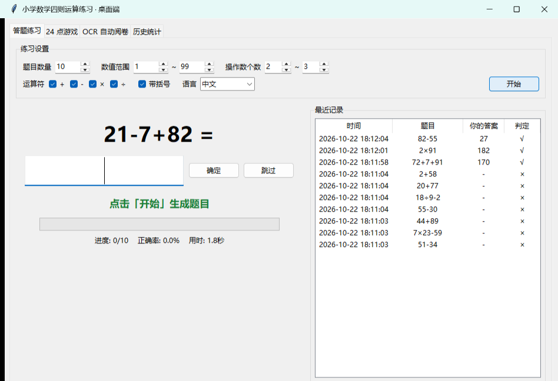
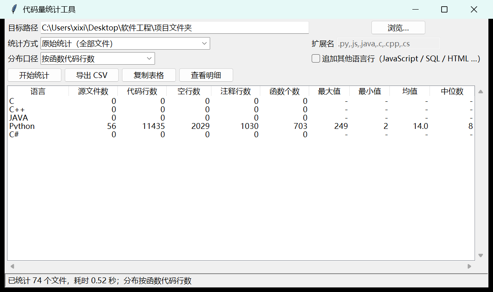

# 刘羽 · Liu Yu

**四川大学 · 计算机学院 · 计算机科学与技术 · 2024 级**

把课上的东西真正做出来，比把课听完更重要。

---

## 关于我

四川大学计算机学院 2024 级本科生。习惯把每门课的期末任务当成一个完整项目来做——从需求、设计、
实现到测试与文档，尽量交付能跑起来的东西，而不是只交一份报告。目前对数据库系统、计算机网络与
工程化实践比较感兴趣。

---

## 项目

### 小学数学四则运算练习器

给小学生练四则运算的练习系统，**命令行 / 网页 / 桌面三端共用同一个 Python 核心库**：出题、判分、
计时、正确率统计、24 点与 OCR 全部来自 `core/`，界面层不含任何算术逻辑，因此三端的统计口径必然一致。
网页端由标准库 `http.server` 暴露 JSON 接口，前端零计算代码；另含自研 OCR 作业自动阅卷
（连通域切字 + 模板匹配 + 束搜索纠错），171 个单元测试全部通过。

`Python 3.14（仅标准库）` · `tkinter` · `http.server` · `原生 HTML/CSS/JS` · `OpenCV`

**[查看源码 →](https://github.com/xixi13yy/four-op-quiz)**

### 多语言代码量统计工具

按语言统计代码行、空行与注释行，并进一步统计**函数个数**与**单个函数代码行数的分布**
（最大 / 最小 / 均值 / 中位数）。纯标准库实现，命令行与 tkinter 图形界面共用同一套统计内核，
支持 `.clocignore` 排除清单、内容去重与二进制识别；函数识别按语言分派，Python 走 `ast` 精确解析。

`Python（无第三方依赖）` · `tkinter` · `ast / 正则` · `代码度量`

**[查看源码 →](https://github.com/xixi13yy/code-stats)**

---

## 技能

| 方向 | 内容 |
|------|------|
| 编程语言 | Python（主）、C / C++、SQL、JavaScript（原生）、汇编语言（课程实验） |
| 数据库 | MySQL 8.0 / InnoDB、数据建模与 E-R 设计、视图 · 触发器 · 存储过程、PyMySQL |
| 计算机网络 | TCP/IP 协议栈、H3C 路由交换配置、网络规划与设计（三层架构） |
| 开发与工具 | Git、Linux 命令行、tkinter 桌面开发、标准库 http.server、matplotlib / python-docx |
| 工程实践 | 单元测试与断言测试、需求分析与 SRS 文档、技术文档排版、代码量统计与度量 |

---

## 联系

- GitHub：[@xixi13yy](https://github.com/xixi13yy)
- 邮箱：（待填写）

最后更新：2026.11
